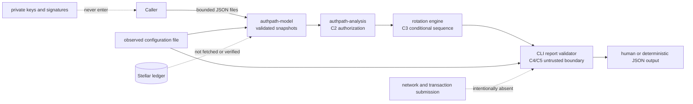

# AuthPath architecture

## Scope and evidence status

AuthPath is a small, offline Rust workspace. C1–C5 established the validated
account model, configured-authorization analyzer, conditional rotation engine,
local CLI, report boundary, and security hardening. C6 documents that existing
implementation for independent review; it does not add a ledger adapter,
wallet, signing service, hosted API, or transaction-submission path.

No approved AuthPath-specific architecture or protocol-semantics
specification was available in the repository or local instruction resources.
The Universal Project Development Playbook v1.3 was also not available as an
authoritative text and was not reviewed. Those absences are recorded rather
than filled with assumptions.

Protocol behavior was compared with primary Stellar material, including
[CAP-2](https://github.com/stellar/stellar-protocol/blob/master/core/cap-0002.md),
[SEP-23](https://github.com/stellar/stellar-protocol/blob/master/ecosystem/sep-0023.md),
[Stellar transaction XDR](https://github.com/stellar/stellar-xdr/blob/main/Stellar-transaction.x),
and the relevant stellar-core transaction, operation, signature-checking, and
SetOptions implementation files. The [C5 audit](c5-audit.md) records the
checked rules, tests, findings, and unresolved boundary.

## System context and data flow

The data flow is local and one-way for analysis. A caller supplies snapshots,
plans, availability declarations, expected configurations, and observed
configurations. The model validates their shape and protocol-domain values;
validation does not turn caller claims into ledger evidence.

`authpath-cli` invokes public model and analysis APIs. It does not duplicate
threshold arithmetic or transition logic. `explain` and `verify` treat reports
as untrusted input and validate them again before presenting their contents.

## Trust boundaries

### Untrusted local input

Every JSON file is bounded before and during reading. Schemas are versioned,
unknown fields are rejected, collections are bounded, and malformed Stellar
identities, duplicate signers, missing required fields, contradictory
availability declarations, and unsupported versions fail closed. The CLI does
not execute code from input and does not interpret input as a path to a secret.

Output installation is also a boundary: a temporary file is written and
synced in the destination directory. Without `--force`, an atomic hard-link
operation creates the final directory entry without replacing an existing or
concurrently created destination. Unsupported filesystem behavior is an
operational error, not an unsafe fallback.

### Provenance and network identity

An account snapshot carries a provenance designation and optional network
identity. `caller_provided` means exactly that the caller supplied the file.
`ledger` provenance requires the required ledger fields in the model, but the
CLI does not fetch, authenticate, or independently verify them. Modeled final
states are marked `modeled`; they cannot claim ledger provenance. `verify`
retains the observed file's provenance and never upgrades it.

### Credentials and execution

No private key, seed phrase, signature byte, wallet connection, RPC endpoint,
database, or transaction submission is accepted by the current product. A
configured public signer and an `available` declaration are separate pieces of
caller metadata. Neither proves private-key possession or successful
transaction execution.

## Workspace components

| Component | Responsibility | Trust statement |
| --- | --- | --- |
| `authpath-model` | Canonical account IDs, Ed25519 signer records, weights, thresholds, availability, and provenance | Typed validation of supplied data; not a ledger reader |
| `authpath-analysis` | C2 authorization findings and C3 ordered rotation modeling | Conditional arithmetic and state transitions; not signature or execution proof |
| `authpath-cli` | Strict JSON adapters, four commands, report validation, output, and exit codes | Offline presentation and comparison; no network or key surface |
| `.github/workflows/ci.yml` | Reproducible format, check, lint, test, and Rustdoc checks | CI evidence for the pinned toolchain only |
| `docs/` and `examples/` | Source-controlled reference, audit record, and deterministic fixtures | Synthetic and caller-provided examples, never ledger evidence |

There is no `authpath-stellar` crate. Ledger or network adapters are a
deliberate non-goal until separately specified and reviewed.

## C1: validated account model

An account snapshot contains a canonical Stellar account identity, master-key
weight, low/medium/high thresholds, zero or more Ed25519 signers, an explicit
availability declaration for each configured signer, and provenance.

Weights and thresholds use the modeled 0–255 account domain. The model enforces
the 20-signer limit, duplicate-key rejection, account-master-key exclusion
from additional signers, threshold boundaries, and canonical public-key
parsing. Zero-weight signer records remain representable in snapshots but are
not treated as usable signing weight. Unsupported signer kinds are not
coerced into Ed25519.

Availability is caller metadata. `Unavailable` is not the same as a zero
configured weight, and `Available` is not private-key possession.

## C2: configured authorization analysis

The C2 analyzer receives a validated transaction description, validated
snapshots, and an explicitly deduplicated set of available Ed25519 identities.
It checks the transaction source at the low threshold and each operation
source against its own account and threshold category. Weights from different
accounts are never combined, and all operations in one transaction use the
pre-transaction state for authorization.

The supported analyzer boundary includes payment, bump-sequence, AccountMerge,
and the supported SetOptions threshold/signer/flag/home-domain variations.
The rotation-plan boundary is narrower: it rejects AccountMerge and unknown
operations because C3 only models the listed authorization-state transitions.

A zero threshold still requires a matching listed positive-weight signer. The
master key contributes only when its identity is declared available. An
additional signer contributes only when both its snapshot availability and the
plan-wide availability declaration allow it. These rules follow the checked
CAP-2 and stellar-core behavior; they do not assert that signatures exist.

## C3: conditional rotation modeling

A `RotationPlan` contains initial snapshots, a global Ed25519 availability
set, and ordered planned transactions. Each positive-weight signer addition
or reweighting has a per-operation availability declaration. The effective
availability for reachability is the intersection of the account-state
declaration and the plan-wide set. A declaration that is missing, contradictory,
or inconsistent with the global set is inconclusive; possession is never
inferred.

For each transaction, the engine:

1. authorizes the transaction and all operations against the pre-transaction
   state;
2. checks availability declarations;
3. applies supported authorization-state changes conditionally;
4. compares caller-supplied expected configurations with the candidate state;
5. evaluates administrative reachability of changed accounts; and
6. commits the candidate state only when the result supplies a valid next
   state.

Expected configurations are caller assertions, not proof of ledger execution.
An expectation mismatch therefore stops dependent analysis and causes later
steps to be `INCONCLUSIVE`. An applied `LOCKOUT_RISK` step is different: the
engine has a valid next modeled state, so later transactions may be evaluated
while the warning remains part of the overall result. An unapplied blocked,
invalid, or inconclusive step has no authoritative next state; later steps are
unevaluated `INCONCLUSIVE` placeholders.

Reachability compares available configured weight with each threshold and
requires a matching positive-weight signer. It distinguishes reachable,
dependent on unavailable signers, and permanently unreachable states when the
represented configuration is complete. It reports administrative reachability
loss as `LOCKOUT_RISK`; it does not claim that a transaction will execute or
that an account is safe.

### C3 classifications

| Classification | Meaning in the model |
| --- | --- |
| `SUPPORTED_REACHABLE` | Authorization is met and changed accounts remain administrable under declared assumptions. |
| `INCONCLUSIVE` | Evidence is missing or unsupported, declarations conflict, an expectation mismatches, or a predecessor halted. |
| `LOCKOUT_RISK` | The transaction is authorized and applied conditionally, but administrative reach is reduced or lost. |
| `INVALID_TRANSITION` | A modeled transition exceeds the signer limit or contradicts a caller-declared reserve shortfall. |
| `BLOCKED` | A supported authorization requirement is not met by the declared identities. |

The plan classification is the worst step classification. It is a severity
summary, not a transaction result.

## C4: local CLI and reports

The four commands are:

- `inspect` displays one validated account snapshot;
- `analyze` invokes the C3 engine and produces a conditional report;
- `explain` validates and explains a report supplied as untrusted input; and
- `verify` compares modeled fields with an observed configuration offline.

JSON contracts are versioned and deterministic. Human and JSON output carry
the same classification semantics. `OFFLINE_CONFIGURATION_MATCH` is reserved
for a complete supported plan whose modeled fields match an observed snapshot;
it never overrides `BLOCKED`, `LOCKOUT_RISK`, `INVALID_TRANSITION`, or
`INCONCLUSIVE`, and it never means `VERIFIED_ON_CHAIN`.

Exit codes distinguish success (`0`), invalid input (`2`), operational failure
(`3`), findings requiring attention (`10`), and inconclusive analysis (`20`).

## C5: security hardening

C5 independently reviewed the supported protocol boundary, tested adversarial
plans and snapshots, hardened standalone report validation, and verified the
atomic no-replace output path. Report validation checks arithmetic,
classification/reason relationships, provenance, unsupported-signer
disclosures, expected-state consistency, and dependent-step halting. The
regression suite includes engine-generated reports so producer and consumer
semantics remain aligned.

The [C5 audit record](c5-audit.md) is the detailed evidence source. It records
that the Universal Project Development Playbook was unavailable, the exact
toolchain and dependencies, the protocol references, confirmed findings, and
known limitations.

## Explicit non-goals and unresolved evidence

AuthPath does not establish:

- cryptographic signature validity or private-key possession;
- ledger-backed snapshot accuracy, transaction acceptance, or ordering;
- balances, reserves, fees, sequence numbers, preconditions, sponsorship, or
  concurrent changes;
- non-authorization effects of supported operations;
- unsupported signer kinds, fee-bump transactions, muxed accounts, or a live
  network state; or
- production safety, adoption, partner relationships, or reviewer approval.

The project is useful as a deterministic pre-submission review aid within its
documented boundary. It is not a substitute for a wallet, ledger query,
signature verification, or an independent protocol review.

## Verification and maintenance

The pinned Rust 1.99.1 workspace and declared Rust 1.87.0 minimum have both
passed the complete locked workspace checks. The repository CI workflow runs
formatting, compilation, Clippy with warnings denied, tests, and Rustdoc. The
dependency audit is run locally with `cargo audit --deny warnings`; its result
is not currently a CI check. Governance and submission evidence are recorded
in [submission-readiness](submission-readiness.md).
